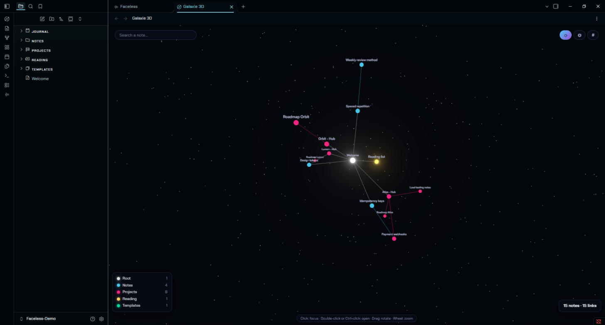

# Galaxie 3D

A colorful 3D view of your Obsidian vault.



- **One color per top-level folder**, so the shape of your vault reads at a glance.
- Node size grows with the number of links; the most linked notes keep their name visible.
- Soft glow, fixed-size starfield, particles flowing along the links of the selected note.
- Search box, click to focus a note and its neighbors, double-click (or Ctrl+click) to open it.
- Click a folder in the legend to hide or show it. Optional tags as nodes.
- Pauses rendering when the view is hidden, to save battery.

The interface follows Obsidian's language (English or French).

## Usage

Run the command **Open 3D galaxy** or click the orbit icon in the ribbon. The view opens in its own tab.

| Action | Effect |
|---|---|
| Click | Focus a note and highlight its neighbors |
| Double-click / Ctrl+click | Open the note |
| Drag | Rotate |
| Wheel | Zoom |

Settings: glow intensity, tags, orphan notes, particles, number of always-visible names.

## Privacy

No network requests, no telemetry, no files read or written outside your vault. Everything is computed from Obsidian's own link index.

## Building

```bash
npm install
npm run build   # writes dist/main.js
```

Built on [3d-force-graph](https://github.com/vasturiano/3d-force-graph) and [three.js](https://threejs.org) (MIT).

---

## Français

Vue 3D colorée du vault : une couleur par dossier principal, halo doux, fond étoilé, recherche, mise en valeur des voisins. Commande **Ouvrir la galaxie 3D**. Clic : centrer · double-clic ou Ctrl+clic : ouvrir · glisser : tourner · molette : zoom. Aucune requête réseau, aucune télémétrie.
